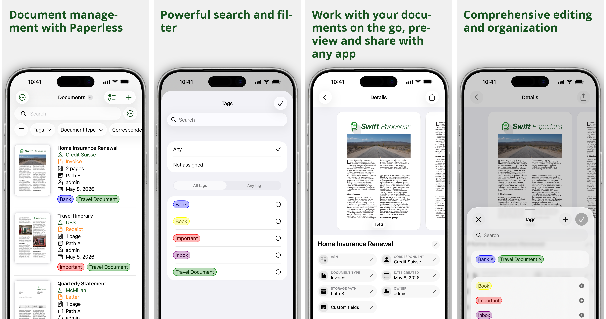

<!-- --8<-- [start:overview] -->
<p align="center" style="margin-bottom:0.25em">


</p>

<h1 align="center" style="margin-top:0em;margin-bottom:0.25em;">
Swift Paperless
</h1>

<p align="center">
<a href="https://apps.apple.com/app/swift-paperless/id6448698521">

</a>
</p>

<h2 align="center" style="margin-top:0.25em;">
iOS app for <a href="https://github.com/paperless-ngx/paperless-ngx">Paperless-ngx</a>
</h2>

<a href="https://crowdin.com/project/swift-paperless">

</a>

<hr/>

<a href="https://apps.apple.com/app/swift-paperless/id6448698521">

</a>

---

**Swift Paperless** native iOS app for the
[Paperless-ngx](https://github.com/paperless-ngx/paperless-ngx) software.
Paperless-ngx is a self-hosted document management system that helps you
organize your documents digitally.

This application requires a self-hosted instance to function!

- [Documentation](https://paulgessinger.github.io/swift-paperless/)

## TestFlight

To get the latest development version of the app, grab it on
[TestFlight](https://testflight.apple.com/join/bOpOdzwL)!

## Building from source

The Xcode project is **generated** with [XcodeGen](https://github.com/yonaskolb/XcodeGen)
from [`project.yml`](project.yml); build settings live in [`Config/`](Config) as
`.xcconfig` files. `swift-paperless.xcodeproj` is not committed — generate it before
opening or building:

```console
brew install xcodegen   # once
just generate           # or: xcodegen generate
open swift-paperless.xcodeproj
```

`just build` / `just test-xcode` regenerate the project automatically. Edit
`project.yml` (targets, sources, dependencies) and `Config/*.xcconfig` (build
settings) rather than the generated project, then re-run `just generate`.

## Contact

If you have any questions or need support create an issue on [GitHub](https://github.com/paulgessinger/swift-paperless/issues/new) or send me a [message](mailto:swift-paperless@paulgessinger.com).

<!-- --8<-- [end:overview] -->

<!-- --8<-- [start:maintenance] -->
## Maintenance

Automation lives in the [`scripts/`](scripts/) package (`swpngx`). Run `swpngx`
via `uv run --project scripts swpngx …` from the repo root (or install the package
so `swpngx` is on your `PATH`).

Device ids, simulator names, bezel PNGs, and framing geometry are defined once in
[`screenshot_devices.toml`](screenshot_devices.toml). [`screenshots.toml`](screenshots.toml)
references those ids for capture; [`frames.toml`](frames.toml) references the same file
for framing. iPhone screenshots use **Pro Max only** (App Store Connect scales for smaller
phones). Check alignment with:

```console
uv run --project scripts swpngx devices check
```

### TestFlight betas

A beta is cut entirely on CI — no commit, no tag, no local build:

```console
just beta                      # from origin/main
just beta --ref release/v1.12  # from a release branch
just beta --dry-run            # CI builds and exports, uploads nothing
```

This previews the notes the build will publish, then dispatches
[`.github/workflows/beta.yml`](.github/workflows/beta.yml) (which you can also
start straight from the Actions tab). CI asks App Store Connect for the build
number, writes it into `Config/Shared/Version.xcconfig` **for that build only**,
archives, signs, uploads, and — after the upload succeeds — creates the
`builds/<version>/<build>` tag and its GitHub prerelease at the built commit. The
tag is the record of what shipped, not the trigger, so it can never name a build
that failed to upload.

Notes come from [`current_changelog.txt`](current_changelog.txt), which
accumulates the user-facing bullets for the *current* marketing version. Nothing
clears it at build time:

- **a build's notes** are the bullets added since the previous build tag; they
  become the prerelease body, which is what the in-app *What's New* screen shows
  (`just beta-notes` previews them)
- **TestFlight "What to Test"** is one `1.11.0 (209)` section per build of the
  current version, newest first — the same shape as `changelog.txt`, scoped to
  the version in flight. App Store Connect caps that field at 4000 characters
  and a version's notes routinely run past it, so whole builds are dropped off
  the oldest end until it fits and a link to the releases takes their place. A
  build is either there in full or not at all; only a single build whose own
  notes exceed the budget falls back to trimming by line. No more clearing the
  changelog by hand to fit
- when the version ships, empty the file in the same commit that bumps
  `MARKETING_VERSION` with `just set-version`

To fix notes after the fact, edit the release body on GitHub (the copy users
read) and, for TestFlight, run `just set-test-notes <build>`.
[`changelog.txt`](changelog.txt) is an offline copy of the per-build notes,
regenerated from the releases with `just changelog-archive`.

### What's New decks

The paged What's New screen for a version is written as YAML front matter at the
top of its release note, `docs/release_notes/v<version>.md`. The docs build
turns each one into `whats_new/<version>.json` on the site, which the app
fetches; a note without a `whats_new` key publishes nothing.

```yaml
---
whats_new:
  pages:
    - title: What's new in 1.11
      subtitle: Tags          # optional
      blocks:
        - type: card          # card, tip (adds tip buttons) or telemetry
          icon: tag           # any SF Symbol name, e.g. ladybug for a fixes card
          tint: teal          # optional: blue, indigo, orange, pink, purple, red, teal
          title: Nested tags
          text: Support for hierarchical tags.
          image: ../assets/tags.png  # optional picture above the card
          image_shadow: true         # optional; a glow in dark mode. Needs transparent corners
          detail: |           # optional Markdown for "Learn more"
            Tags can now have parents. 
---
```

Relative links and images in `detail`, and a card's `image`, resolve against
`https://swift-paperless.app/release_notes/`, so an image in `docs/assets/` is
`../assets/<name>`. An `image` has to exist in the docs; the check below
fails if it doesn't. Check a deck before pushing with:

```console
uv run scripts/whats_new.py build docs/release_notes site/whats_new
```

If a deck has a mistake, this command and the docs build both stop and name the
file and field. While editing, run `just whats-new-serve` and open the
"Generated" preview in `WhatsNewDeckView.swift`: it rebuilds the deck into
`docs/whats_new/` on every save, the preview reloads within a second, and
images load from the local docs server on port 5006, as they would from the
site. When copying a release note into its GitHub release, leave out
the front matter block: it is only for the app.

### App Store screenshots

The whole pipeline runs locally with `just`; nothing needs fastlane.

```console
just demo-reset            # Paperless-ngx in Docker, seeded with the fixture PDFs
just screenshots           # build, capture every locale, frame
just screenshots-preview   # review in the browser
just deliver-preview       # dry run against App Store Connect
just deliver               # upload metadata and screenshots
```

**1. Demo backend.** `just demo-up` starts Paperless-ngx on port 9988 and
uploads the PDFs in `Preview PDFs/`; `just demo-reset` wipes it first, so it
holds only those documents (setup is not idempotent). Pin the image with
`uv run --project scripts swpngx capture setup --pngx-tag 2.19.4`, or add
`--random-tags 1000` (and `--random-correspondents`, `--random-document-types`)
for UI stress testing. `just demo-down` removes it.

**2. Capture.** `swpngx capture capture` (config:
[`screenshots.toml`](screenshots.toml)) builds the app, reinstalls it on each
simulator, and takes one screenshot per step and locale. Every step is a fresh
launch in preview mode that routes through its `urls` (x-paperless deep links,
see `DataModel/Sources/DataModel/Route.swift`; `device_urls` overrides them per
device), so no taps or link prompts are involved. It writes files like
`store/screenshots/en-US/iPhone_18_Pro_Max-01_documents.png`; the prefix is
the device `id` from [`screenshot_devices.toml`](screenshot_devices.toml).
Simulator UDIDs in `screenshots.toml` are per machine.

**3. Frame.** `swpngx promo screenshots` draws each capture in a device frame
on the promo background with a headline from
[`store/promo/headlines.toml`](store/promo/headlines.toml), and writes
`store/screenshots/framed/<App Store locale>/*-framed.png` at 1320 × 2868
(iPhone) and 2064 × 2752 (iPad). The scene is
`store/promo/scenes/screenshot.html`; long headlines shrink to fit. It renders
with Playwright's Chromium (`uv run --project scripts playwright install
chromium` once).

`swpngx frame` is the older framer: Apple device bezels and titles from
[`store/screenshots/Screenshots.xcstrings`](store/screenshots/Screenshots.xcstrings)
(config: [`frames.toml`](frames.toml); bezels via `swpngx frames download`,
font via `swpngx fonts download`). It writes the same file names, so either can
feed `just deliver`.

**Review** with `just screenshots-preview`, which serves the framed screenshots
and the metadata for every locale.

**Upload** metadata and framed screenshots with [`asc`](https://github.com/rorkai/App-Store-Connect-CLI)
(`brew install asc`):

```console
just deliver-preview    # dry run
just deliver            # metadata + screenshots
just deliver-metadata   # metadata only (What's New, description, …)
```

`just deliver` runs `swpngx deliver` for `MARKETING_VERSION` from
`Config/Shared/Version.xcconfig`, creating that App Store version if it does not
exist yet. It reads metadata from `store/metadata/`, sets the copyright and
categories, and replaces all screenshots of each device in
[`screenshot_devices.toml`](screenshot_devices.toml) that has framed PNGs. No IPA
is uploaded; TestFlight builds go through `just beta` separately. `just
deliver-preview` also validates locally, then shows the changes against App Store
Connect once the version exists.

`store/metadata/default/` applies to every locale, including `en-US`, unless
the locale directory overrides a file.

**What's New** is edited only in `store/metadata/default/release_notes.txt`
and applies to every locale.

Authentication uses the `asc auth login` credentials, or the same App Store
Connect API key as TestFlight (`APP_STORE_CONNECT_API_KEY_ID`,
`APP_STORE_CONNECT_ISSUER_ID`, and `APP_STORE_CONNECT_KEY_FILEPATH` or
`APP_STORE_CONNECT_KEY_CONTENT`).

PNG screenshots under `store/screenshots/` are gitignored; generate them locally
before upload.

### Panorama montage

Concatenate framed screenshots (adjust the glob for your device name):

```console
montage store/screenshots/framed/en-US/iPhone_18_Pro_Max-0*-framed.png \
    -tile 4x1 -geometry +20+0 panorama.png
```

If `montage` fails with ``unable to read font `'``, the ImageMagick install has no
configured fonts; pass one explicitly, e.g.
`-font /System/Library/Fonts/Supplemental/Arial.ttf`.

`docs/panorama.png` is a symlink to the top-level `panorama.png`, so regenerating
it updates both the README and the docs site.
<!-- --8<-- [end:maintenance] -->

## Release tooling

See [building releases](docs/development/releases.md) for the shared
CI pipeline and the `just beta` / `just release` commands.
