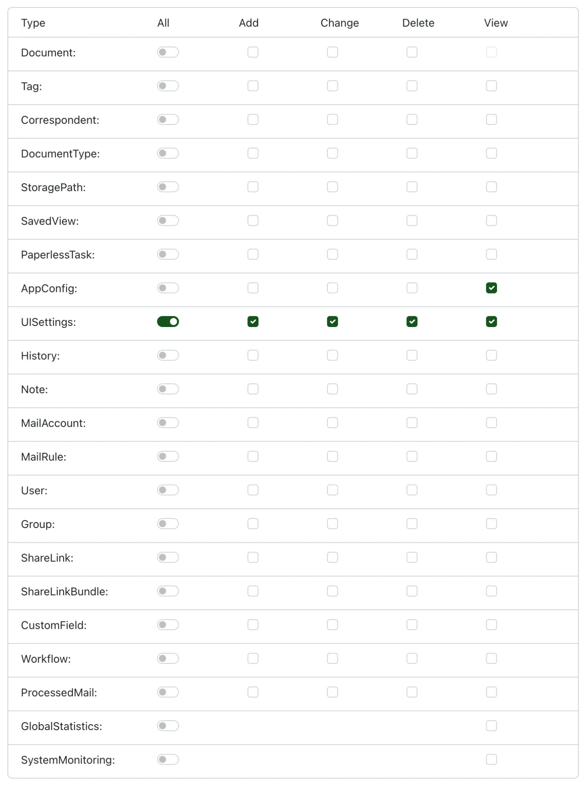

# Minimum permissions

Permissions in Paperless-ngx control what resources a logged in user has access to.
Generally, Swift Paperless will respect the given permissions and not try to load resources
that the user will not be able to access.

For the app to function correctly, it needs to be able to query information about the logged in user itself,
which includes the level of permissions the user has. Without this level of access, the functionality of the app cannot be provided.

Please ensure that the user you're trying to log in with has at least the *UI Settings* permissions set in the web interface under *Users & Groups*. The screenshot also shows *View* on *App Config*, which is recommended for Paperless-ngx 3.5 and later (see below):

## App Config (Paperless-ngx 3.5 and later)

Since Paperless-ngx 3.5, reading the server configuration requires the *View* permission on *App Config*. Earlier versions give it to every logged in user.

This permission is optional. Without it, the app works normally, but the document scanner can't read the ASN barcode prefix configured on the server.

Swift Paperless versions before 1.11 fail to load tags, correspondents and other data when this permission is missing, and show a permissions error that points to this page. Either grant *View* on *App Config* to the user, or update the app.
