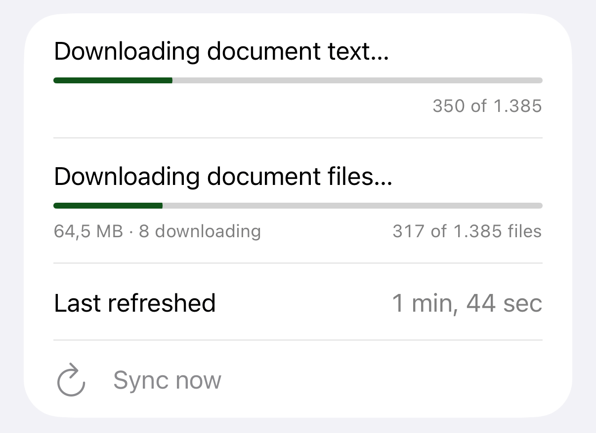
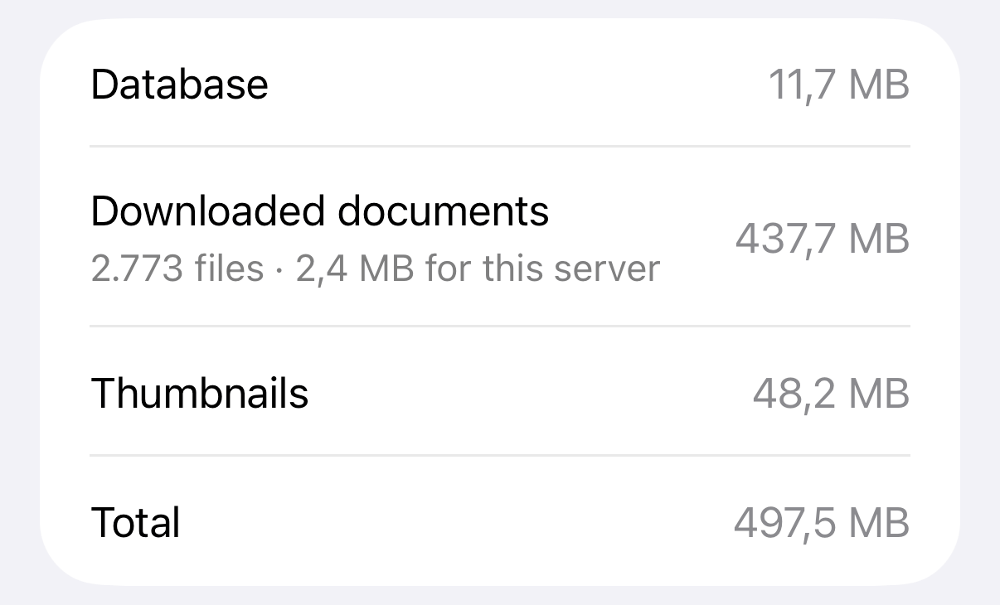
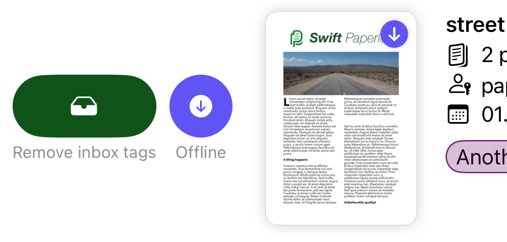
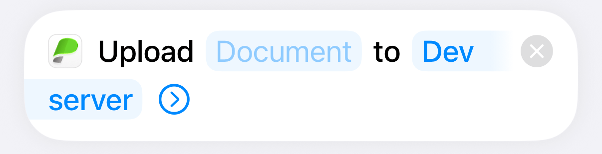
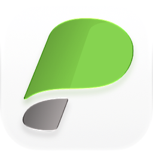

---
whats_new:
  pages:
    - title: What's new in 1.11
      blocks:
        - type: card
          icon: paintbrush
          tint: blue
          image: ../assets/app_icon_v1.11.png
          image_shadow: true
          title: A new app icon
          text: >
            Brand-new logo made by the folks over on **[The Iconfactory](https://iconfactory.com/)** 🙌.
            I think it's the best one yet.
        - type: card
          icon: icloud.and.arrow.down
          tint: teal
          title: Offline browsing
          text: >
            The most requested feature by far: your documents are now **available without a connection!**
          detail: |
            Documents you open are kept on your device, with their notes, file
            metadata and thumbnails, so they open instantly next time, even without a
            connection.

            ### Entire library

            

            Choose "Entire library" under **Offline browsing** to keep every saved
            view, your full document list and every PDF on the device.

            - Downloads run in the background, also while the app is closed
            - Stays on Wi-Fi unless you turn on "Sync over cellular"
            - Pauses when the device is low on storage

            > Background downloads need Background App Refresh to be on for the app.

            ### Offline & Sync

            A new settings screen shows sync progress, what failed and why, how much
            data the app has transferred, and how much space offline data takes up.

            
        - type: card
          icon: pin
          tint: orange
          title: Keep offline
          text: Pin individual documents, whole saved views, or your entire library.
          detail: |
            Keep a document, or a whole saved view, on your device whatever the
            offline browsing mode.

            

            - Downloaded right away, on any connection
            - Never removed to free up space
            - Follows new versions from the server

            The new "Kept offline" view in the saved view selector lists everything
            you've kept.
    - title: Also new
      blocks:
        - type: card
          icon: square.and.arrow.up
          tint: indigo
          title: Upload from Shortcuts
          text: A new Shortcuts action uploads files without opening the app.
          detail: |
            Upload files from the Shortcuts app without opening Swift Paperless, for
            example as part of an automation.

            

            - Pick the target server
            - Optionally set a title, document type, correspondent and tags

            > Leave the title empty to let the server derive one from the filename.
        - type: card
          icon: doc.on.doc
          tint: purple
          title: Duplicates
          text: See which documents share the same file, on Paperless-ngx v3.
          detail: |
            On Paperless-ngx v3, a document that shares its file content with others
            lists them in its details, and you can open them from there.

            > The new "Duplicates" filter, for documents with or without duplicates,
            > needs Paperless-ngx v3.2 or later.
        - type: card
          icon: tag
          tint: pink
          title: Default upload tags
          text: Choose tags that are preselected on every upload.
        - type: card
          icon: lock.shield
          tint: red
          title: Two-factor OIDC login
          text: OIDC logins now support TOTP codes from Paperless-ngx.
    - title: And more
      blocks:
        - type: card
          icon: ladybug
          tint: orange
          title: Fixes and polish
          text: Clearer error messages and many fixes across the app.
          detail: |
            ### Clearer errors

            - Connection errors now say what went wrong
            - Permission errors say which operation was refused
            - Changes that fail while offline tell you they weren't saved
            - A list that can't load says so and offers to retry

            ### Fixes

            - Pull to refresh picks up a new version of an open document
            - No more "Insufficient permissions" when launching offline
            - No more "No documents" flash while the list loads on launch
            - Importing several files at once no longer stops early
            - Task results show up again on Paperless-ngx v3
            - A failed delete no longer hides the item in Settings or Trash
            - Fixed a crash when opening a filter while another was open
            - The per-app language selection works again

        - type: card
          icon: star
          tint: purple
          title: Full release notes
          text: "See the [full release notes](v1.11.0/) for everything else."
        - type: tip
          icon: heart
          tint: pink
          title: Support the app
          text: If you enjoy the app, consider leaving a tip.
---

# v1.11.0

This release is a fairly big one, and I've been working on this since summer!

## 🚀 Features

### New app icon

{ width="128" }

A brand-new icon, made by the folks at
[The Iconfactory](https://iconfactory.com/). The previous one is still
available in Settings as an alternative icon.

### Offline browsing

The most requested feature: your documents are now available without a
connection. Documents you open are kept on your device, together with their
notes, file metadata and thumbnails. A document whose PDF is already
downloaded opens straight away, while the app checks the server for a newer
copy in the background.

With the default "Recently browsed" mode, documents you've opened are kept
within a 500 MB budget, removing the ones you opened longest ago first.

#### Entire library

{width="400"}

Choose "Entire library" under **Offline browsing** to keep every saved view,
your full document list, and the PDF, notes and file metadata of every
document on the device. All of your configured servers stay synced, not just
the one you're viewing.

- Downloads run in the background, also while the app is closed
- Stays on Wi-Fi unless you turn on the new per-server "Sync over cellular"
  setting, and pauses in Low Data Mode
- Pauses when the device is low on storage
- Removed again when you switch back to "Recently browsed"

!!! note
    Background downloads need Background App Refresh to be on for the app.

#### Offline & Sync

A new settings screen shows the sync stage and progress, which parts of the
last sync failed and why, how much data the app has transferred, and how much
space the offline data takes up on your device.

{width="400"}

### Keep offline

{width="400"}

Pin individual documents or whole saved views with the new "Keep offline"
action, whatever the offline browsing mode:

- Downloaded right away, on any connection
- Never removed to free up space
- Follows new versions from the server

The new "Kept offline" view in the saved view selector lists everything you've
kept.

### Upload from Shortcuts

A new "Upload Document" action in the Shortcuts app uploads files to Paperless
without opening the app, for example as part of an automation. You can pick the
target server, and optionally set a title, document type, correspondent and
tags. Leave the title empty to let the server derive one from the filename.

### Duplicates

On Paperless-ngx v3, a document that shares its file content with others lists
them in its details, and you can open them from there. On v3.2 and later, a new
"Duplicates" filter finds documents with or without duplicates.

### ✨ Other Features

- New per-server "Default upload tags" setting in Preferences: the chosen tags
  are preselected when uploading a document, including from the share sheet
- OIDC logins now support TOTP (two-factor authentication) codes from
  Paperless-ngx
- Open the active server's web interface in the browser from Settings
- A clear button on the document title edit field
- On iPad you can refresh an open document from the toolbar

## 💪 Improvements

- Title search and title and content search now use the new search API on
  Paperless-ngx v3.0 and later, so the same search returns the same documents
  as the web interface. The content-only search mode is no longer offered,
  following the web interface; existing filters, saved views and links that
  use it keep working
- Connection errors now say what went wrong: that your device is offline, that
  the server's address can't be found, that it isn't responding, or that the
  connection dropped
- Permission errors now say which operation was refused, e.g. "Delete not
  permitted", and name the affected item
- Saving, editing or deleting something while offline now tells you the change
  was not saved, instead of failing silently
- When a document list can't be loaded, it now says so and offers to retry,
  instead of showing "No documents"
- Document lists now update when one of their documents changes, in the app or
  on the server
- The share extension now reports errors when saving a document fails, and
  tells you when you need to sign in again
- Changing the default sort or search mode in Preferences now applies to the
  document list right away
- Server connections are now stored in a local database. They are migrated
  automatically
- Large document downloads no longer buffer the whole file in memory, reducing
  memory pressure, especially in the Share Extension
- The app no longer freezes briefly while reading or writing its offline cache

## 🐛 Bug Fixes

- Pulling to refresh an open document now picks up a new version added on the
  server, and retries a preview or original file that failed to download
- Starting the app before your permissions have loaded, for example while
  offline, no longer shows "Insufficient permissions"
- Recover the correct API version after launching while the server is
  unreachable
- Fix a crash when one filter was opened while another was still on screen
- Importing several files at once no longer closes before the last file
- Task results and error messages show up again on Paperless-ngx v3, including
  files rejected as duplicates
- Items in the Settings lists and Trash stay in place until a delete succeeds,
  and swipe-to-delete in a searched list deletes the item you swiped
- A failed removal of a document's inbox tags is now reported
- The document list no longer briefly says you have no documents while loading
  on launch
- Dates now use the short style, so a custom date format applies
- Restore the per-app language selection
- Fix the "Deep link (with backend)" option missing from a document's share
  menu
- Fix untranslated strings in document notes
- Stop pull-to-refresh jumping on release in the document list and tag picker
